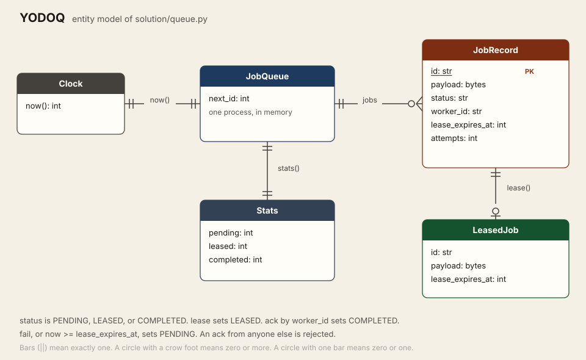

# YODOQ

**Y**our **O**wn **D**on't-**D**rop **Q**ueue, implemented in Python 3.

A single-process, in-memory job queue. Workers can crash mid-job and acks can vanish in transit. The same job is leased again until a holder acks it, so work is delivered at least once, and duplicate runs stay bounded by how often those failures happen.

## Getting started

`solution/queue.py` is the queue. `main.py` is the harness that grades it.

1. **Basic operations.** `enqueue`, `lease`, `ack`, `fail`, and `stats`.
2. **Crash tolerance.** A leased job whose lease has expired goes back to `PENDING` and can be leased by another worker.
3. **Bounded duplication.** A crash or a dropped ack re-leases that same record. The queue does not create a second job for the retry.

## Architecture



`New(clock)` returns a `JobQueue`. The clock only needs `now()` in milliseconds. The harness owns a `TestClock` and advances it, so lease expiry happens without sleeping.

Each job is one `JobRecord` in a dict, keyed by `job-1`, `job-2`, and so on. Dict order is the queue order. `enqueue` copies the payload with `bytes()` and stores the record as `PENDING`.

`lease(worker_id, lease_ms)` reclaims expired leases, then takes the first `PENDING` record. It sets `LEASED`, records `worker_id`, sets `lease_expires_at` to `now() + lease_ms`, increments `attempts`, and moves that record to the end of the dict so the next pending job is served first. The caller receives a `LeasedJob` (`id`, `payload`, `lease_expires_at`). An empty queue returns `None`.

`ack(worker_id, job_id)` completes the job only when that worker still holds a live lease. Any other caller, including the worker whose lease has since expired or been given to someone else, gets `ValueError`. `fail` uses the same ownership check and returns the record to `PENDING` immediately.

`stats()` reclaims expired leases first, then counts `pending`, `leased`, and `completed`. An expired lease therefore shows up as pending.

| Piece | Where | Role |
|---|---|---|
| `JobQueue`, `LeasedJob`, `Stats`, `New` | `solution/queue.py` | The queue |
| Package exports | `solution/__init__.py` | `import solution` |
| `TestClock`, `Worker`, `FailureSimulator`, `ExecutionLedger` | `main.py` | Three-level harness |
| Entity diagram | `docs/yodoq-er.svg` | The figure above. `docs/yodoq-er.drawio` is the same diagram for draw.io |

`main.go`, `solution/queue.go`, and `go.mod` are the original Go exercise. `Enqueue`, `Lease`, `Ack`, `Fail`, and `Stats` there still return "not implemented". The running code is the Python package.

## Implementation levels

### Level 1: Basic operations

`level1` in `main.py` checks one queue with a manual clock and no injected failures.

- `enqueue` then `lease` returns the same payload. `ack` removes it from the leasable set.
- Ten further jobs are leased and acked in order.
- `fail` makes that job leasable again, and a second worker can take it.
- After a lease of 1000 ms, the clock jumps 2000 ms. The next `lease` gives the job to another worker. The first worker's `ack` raises `ValueError`.

### Level 2: Crash recovery

Five workers, 200 jobs, lease of 1000 ms, 100 ms of simulated processing, crash rate 20%, ack-drop rate 0, RNG seed 42.

A crash happens after `lease` and before `ExecutionLedger.record`, so that attempt is not an execution. The lease then expires (`run_until_drained` advances the clock 2000 ms after each round of workers) and another worker leases the same job. Because every recorded run is followed by an ack, duplicates stay at zero.

Latest run: 200 executions, 0 jobs lost, 0 excess executions.

### Level 3: Reliability under stress

The same shape as level 2, with crash rate and ack-drop rate set to the same value and swept through 0.1%, 1%, 5%, 10%, 20%, 30%, and 50%. The RNG seed is `int(rate * 10000)`.

A dropped ack is recorded in the ledger and then skipped. The queue still holds the lease until it expires, then another worker runs the job. That second run is the duplicate.

Latest run, 200 jobs at every rate, 0 lost throughout:

| Crash and ack-drop | Excess executions | Duplication | Total executions |
|---|---:|---:|---:|
| 0.1% | 0 | 0.0% | 200 |
| 1% | 1 | 0.5% | 201 |
| 5% | 11 | 5.5% | 211 |
| 10% | 21 | 10.5% | 221 |
| 20% | 69 | 34.5% | 269 |
| 30% | 76 | 38.0% | 276 |
| 50% | 153 | 76.5% | 353 |

Duplication here is `total executions / job count − 1`. It tracks the ack-drop rate. At 50% it is 76.5%, inside the harness's "about twice the failure rate" band.

## Prerequisites

Python 3.9 or newer. The standard library is enough. Insertion-ordered dicts (Python 3.7+) are what make `lease` FIFO.

## Running the tests

```bash
python3 main.py
```

Level 1 prints a success or error line per check. Levels 2 and 3 print lost jobs, excess executions, and the duplication rate. The process exits 0 either way. Read the `[ERROR]` lines.

## Test results — what to look at

- **Jobs lost.** Jobs the ledger never recorded. This implementation finishes with 0 at every level. A lost job is a record that stayed `PENDING` or `LEASED` until the harness gave up (200,000 rounds).
- **Excess executions.** For each job that ran more than once, the runs after the first. A job that ran 3 times contributes 2. Level 2 allows up to `job_count * crash_rate * 2` (80 at 20%). The run above is 0, because crashes are not counted and acks are not dropped.
- **Duplication rate.** `total executions / job count − 1`. On level 3 it follows the ack-drop rate, because only a recorded run whose ack is dropped causes another recorded run.
- **Drain.** The harness stops when `stats()` reports `pending == 0` and `leased == 0`. It does not print a separate throughput number.

## Success criteria

Met by `python3 main.py` on the current queue:

- Level 1 passes enqueue, lease, ack, the ten-job batch, fail-and-release, and stale-ack rejection.
- Level 2 loses 0 of 200 jobs at a 20% crash rate, with 0 excess executions.
- Level 3 loses 0 jobs from 0.1% through 50% crash and ack-drop.
- Duplication stays on the order of the ack-drop rate (76.5% at a 50% rate), rather than retrying a single job without bound inside one drain.

## What this queue leaves out

`attempts` increments on every `lease` and is not a cap. A job is retried until some holder acks it.

There is one dict in one process. Callers are serialized by the Python process. A restart drops every record. `stats()` is the operator view: three counts, after expired leases have been returned to `PENDING`.

Lease order is FIFO via dict order, with a retried job moved to the back. The harness round-robins its five workers. The queue does not rank jobs or assign workers.
